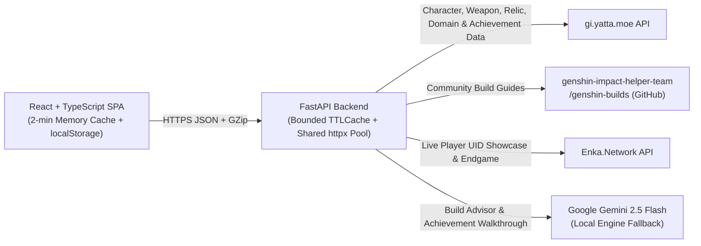

# High-Level Architecture — Irminix

## System Overview

**Irminix** is a stateless, database-free full-stack web platform with clean modular separation (`api/`, `core/`, `schemas/`, `services/` on the backend; `components/`, `contexts/`, `lib/`, `services/`, `types/` on the frontend), using an async bounded in-memory TTL cache and browser `localStorage` instead of a persistent database.

---

## Data Sources & Ownership Matrix

| Domain | Primary Source | Secondary / Enrichment Source | Needs Manual Update? |
|---|---|---|---|
| **Character Catalog & Kit** | `gi.yatta.moe` (`/avatar`, `/avatar/{id}`) | `genshin-impact-helper-team/genshin-builds` | Only `YATTA_SLUG_ALIASES` / `REGION_MAP` if new edge-case slugs appear |
| **Build Guides (Weapons, Artifacts, Stats, Talents)** | `genshin-impact-helper-team/genshin-builds` | `gi.yatta.moe` (icons, Lv.1/90 weapon stats, R1–R5 passives, 2pc/4pc bonuses) | `GENERIC_SET_FALLBACKS` only if a new generic 2pc token is added |
| **Tier List** | Hardcoded `TIER_OVERRIDES` (`tierlist_service.py`) | Character metadata from `gi.yatta.moe` | **Yes** — update `TIER_OVERRIDES` and `patchLabel` every new Genshin patch |
| **Database: Weapons & Artifacts** | `gi.yatta.moe` (`/weapon`, `/reliquary`) | Helper Team reverse-index (`recommendedFor`) | No |
| **Database: Elements** | `gi.yatta.moe` (`/elements` for Resonances) | Static `ELEMENTAL_REACTIONS` (`database_service.py`) + `RESONANCE_ELEMENT_MAP` (`DatabaseView.tsx`) | **Yes** — if new Elemental Reactions or Resonances are added |
| **Daily Domains & Material Planner** | `gi.yatta.moe` (`/dailyDungeon`, `/material`, `/avatar/{id}`) | — | No |
| **Player Showcase & Endgame** | `Enka.Network` (`/api/uid/{uid}`) | `gi.yatta.moe` (newer character/weapon/relic fallback names & icons) | No |
| **Achievements & Walkthroughs** | `gi.yatta.moe` (`/achievement`) | Google Gemini 2.5 Flash (`_deterministic_guide` fallback) | No |
| **Build Advisor** | Google Gemini 2.5 Flash (`gemini-2.5-flash`) | `_deterministic_advisor` fallback + Enka showcase + Helper Team guide | No |

---

## Caching & Latency Strategy

1. **Shared HTTP Connection Pool (`app/core/http.py`)**: A single persistent `httpx.AsyncClient` reuses TLS/TCP keep-alive connections across all upstream API calls and cleans up stale clients if the event loop changes.
2. **Background Startup Warmup & Single-Flight Locks**: `app/main.py` pre-warms the character catalog, gear recommendation reverse-index (`_GEAR_RECS_LOCK`), and daily material-to-character map (`_MAT_MAP_LOCK`) asynchronously at startup, while `fetch_yatta_json` (`app/core/constants.py`) protects individual Yatta endpoints with per-key `asyncio.Lock` stampede guards.
3. **Cache Poisoning Prevention**: Upstream fetchers only write to `TTLCache` when responses are valid and non-empty so transient network/upstream outages never get cached for hours.
4. **Multi-Tier Bounded In-Memory TTL Cache (`app/core/cache.py`, `max_size=2000`)**:
   - **6 hours**: Character catalog, `CharacterDetail`, Helper Team tree/builds, gear `recommendedFor` reverse-index, Yatta weapon/reliquary/dailyDungeon/material indexes, Achievement catalog.
   - **24 hours**: Individual weapon passive details, Yatta character material-plan details & material-to-character index, Enka+Yatta combined metadata stores, Gemini AI achievement walkthroughs.
   - **30 minutes**: Gemini AI Build Advisor evaluations (keyed with showcase fingerprint so UID refreshes invalidate stale advice).
   - **1–10 minutes**: Enka.Network player UID profiles (respecting Enka `ttl`, bypassable via `?refresh=true`).
   - *Note*: Fallback responses from `irminsul-local-engine` triggered by transient AI errors (`429` / `503`) are **not** cached so subsequent requests retry Gemini automatically.
5. **GZip Compression**: `GZipMiddleware(minimum_size=1000)` compresses large JSON payloads (such as the 1,900+ item achievement catalog) by ~75%.
6. **Frontend Caching**: `src/services/api.ts` maintains a 2-minute in-memory TTL cache, while `SessionContext` and `AchievementTrackerPanel` persist UID session and achievement checklists in `localStorage`.
