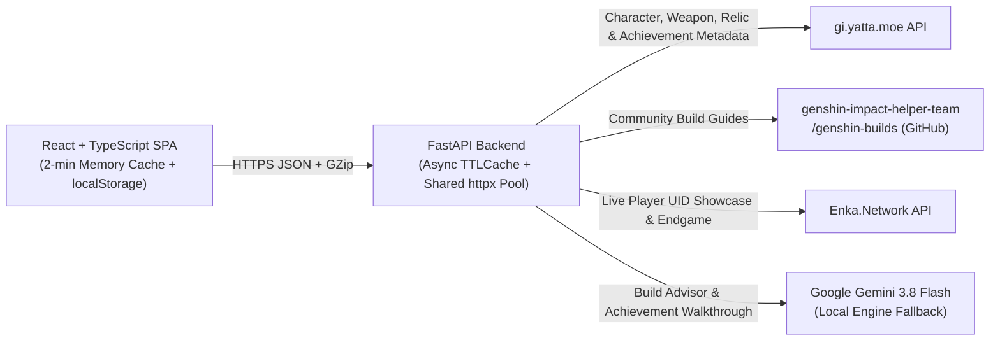

# High-Level Architecture — Irminix

## System Overview

**Irminix** is a stateless, database-free full-stack web platform. It mirrors Valvix's clean modular separation (`api/`, `core/`, `schemas/`, `services/` on the backend; `components/`, `contexts/`, `lib/`, `services/`, `types/` on the frontend) while replacing SQLite/SQLAlchemy/Alembic with an async in-memory TTL cache and browser `localStorage`.

---

## Caching & Latency Strategy

1. **Shared HTTP Connection Pool (`app/core/http.py`)**: A single persistent `httpx.AsyncClient` reuses TLS/TCP keep-alive connections across all upstream API calls.
2. **Background Startup Warmup & Single-Flight Locks**: `app/main.py` pre-warms the character catalog, gear recommendation reverse-index (`_GEAR_RECS_LOCK`), and daily material-to-character map (`_MAT_MAP_LOCK`) asynchronously at startup so initial Database and Planner requests avoid cold-cache stalls or duplicate upstream bursts.
3. **Concurrent Upstream Resolution**: Independent upstream calls (`get_helper_team_index` + `_fetch_yatta_avatars`, `weapons` + `reliquary`, `dailyDungeon` + `material`, Enka + Yatta metadata stores) run concurrently via `asyncio.gather()`.
4. **Multi-Tier In-Memory TTL Cache (`app/core/cache.py`)**:
   - **6 hours**: Character catalog, `CharacterDetail`, Helper Team tree/builds, gear `recommendedFor` reverse-index, Yatta weapon/reliquary/dailyDungeon/material indexes, Achievement catalog.
   - **24 hours**: Individual weapon passive details, Yatta character material-plan details & material-to-character index, Enka+Yatta combined metadata stores, Gemini AI achievement walkthroughs.
   - **30 minutes**: Gemini AI Build Advisor evaluations.
   - **1–10 minutes**: Enka.Network player UID profiles (respecting Enka `ttl`, bypassable via `?refresh=true`).
   - *Note*: Fallback responses from `irminsul-local-engine` triggered by transient AI errors (`429` / `503`) are **not** cached so subsequent requests retry Gemini automatically.
4. **GZip Compression**: `GZipMiddleware(minimum_size=1000)` compresses large JSON payloads (such as the 1,910-item achievement catalog) by ~75%.
5. **Frontend Caching**: `src/services/api.ts` maintains a 2-minute in-memory TTL cache, while `SessionContext` and `AchievementTrackerPanel` persist UID session and achievement checklists in `localStorage`.
